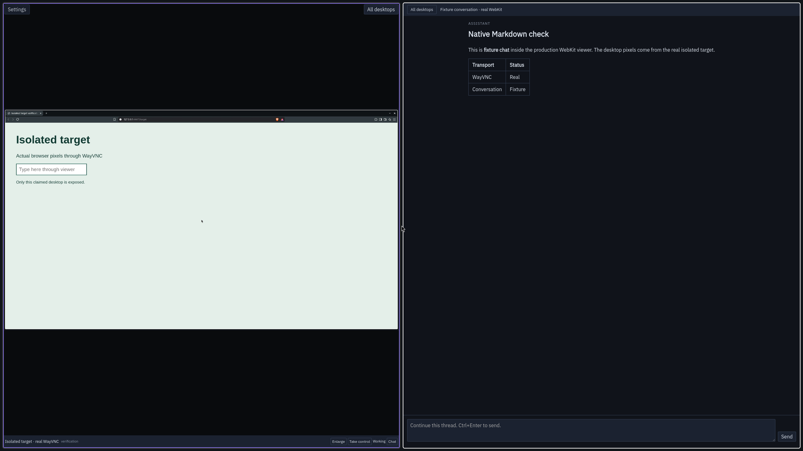

# Agent Desktops

Agent Desktops is an app for watching and controlling agents' background Hyprland desktops while you keep using your computer. It includes the desktop runtime, a native GTK viewer, MCP tools, and an agent skill. Optional connections add viewing across machines, a private web dashboard, and chat with verified T3 conversations.

The native viewer fits up to eight live screens per page. Enlarge a desktop, choose **Take control** for mouse and keyboard input, and press **Escape** to return to watching. Agents remain active while you control a desktop. Closing the viewer disconnects its streams and leaves agent work running.



The screenshot shows a test conversation beside real WayVNC desktop pixels.

## Install and start

Install the `agent-desktops` Arch package, then run this from a terminal in your graphical session:

```sh
agent-desktops setup
```

The optional Omarchy installer runs setup for you:

```sh
omarchy install ai agent-desktop
```

The Omarchy command becomes available when its integration and the companion package recipe are accepted. Before then, build the package recipe linked from the release notes, or install from a source checkout with `npm ci --ignore-scripts` followed by `python3 install.py`.

Restart your agent CLI to discover the installed skill. Ask it to use an agent desktop. The viewer opens for the first active desktop; open **Agent Desktops** from the application launcher whenever you want to look in. Claude and Codex receive skill links. Other clients can use the same authenticated MCP tools through the command helper:

```sh
agent-desktop tool status '{}'
```

Local desktops need neither T3 nor remote networking. Requirements are Hyprland 0.55 or later with Lua configuration, systemd user services, Node.js 20+, Python 3.11+, GTK 3, PyGObject, WebKitGTK 4.1, WayVNC, jq, grim, wtype, wlrctl, Wayland, xkbcommon, and Xwayland. Source setup also needs npm, a C compiler, make, pkg-config, wayland-scanner and the Wayland/xkbcommon development files. It compiles the native helpers before changing services. Packages must include the compiled helpers. Optional `--monitor DP-1`, `--port 7873`, and first-install `--no-start` flags are available through `agent-desktops setup --help`.

Agent input uses physical keyboard mappings and bounded pointer gestures. The `drag` tool takes the latest `frame_id`, starting `x`/`y`, destination `to_x`/`to_y` and optional `duration_ms`. A gesture releases its button before returning. Keyboard and pointer helpers are adapted from [Omabox](native/UPSTREAM.md) and refuse targets outside the selected agent desktop.

`wait` now defaults to visible stillness, with `ms` as the maximum budget and `quiet_ms` as the quiet interval. Choose `mode: "change"` to wait for a change, `"settle"` for a change followed by stillness, or `"sleep"` for the previous fixed-delay behavior. Unmet conditions return `isError` and `satisfied: false`; capture failures remain errors. Waiting invalidates old coordinates and never renews a lease. Hyprland uses screencopy damage events; Xvfb compares captured frames only during the requested bounded wait.

## Settings and use

**Settings** controls automatic opening, desktop idle time, browser startup, stream quality, notifications, and the optional remote hub. The opening preference applies immediately and survives updates. A remote connection needs an HTTPS URL and an absolute path to its private token file. Settings never displays or saves the token itself. Clear both fields to return to this machine; close and reopen the app after changing the connection. Service errors appear separately from a healthy empty viewer.

The viewer follows this computer's active Omarchy palette without interrupting streams. Other Hyprland installations use its built-in palette. Unreachable hosts keep their last known desktops marked reconnecting. The next work batch opens the viewer after a dismissed batch has ended.

**Chat** is enabled only for a verified, supported T3 conversation. Its disabled control explains missing support or unresolved ownership. Chat opens beside that conversation's desktops and keeps replies on the original thread. Approval and setup actions that require T3's controls must be completed in T3. See [T3 setup](docs/integrations.md#t3-code).

Desktop input and browser profiles are separate. Agents retain the logged-in user's filesystem and command permissions. Commands and input renew leases; observation and watching do not. Abandoned desktops close after the configured idle timeout, 30 minutes by default. The countdown shows the actual deadline. Use a bounded keep-open override for deliberate waits. Browser profiles survive release. Claiming a desktop inhibits normal idle sleep until release or expiry.

## Backends and audio

Hyprland is the default backend. Its desktops start muted, including Minecraft and other OpenAL applications using PipeWire JACK. Each viewer audio control affects only its desktop. Normal desktop sounds remain independent. PipeWire graph commands `pw-dump`, `pw-cli`, and `pw-link` are required for this control.

Headless Linux machines can use the Xvfb backend:

```sh
python3 install.py --backend xvfb
```

It requires Xvfb, xauth, xdpyinfo, xprop, openbox, xdotool, maim, x11vnc, dbus-run-session, systemd user services, and Python Pillow. It installs the local server and command helper without Hyprland or a native viewer. Its VNC endpoints bind loopback. View it through a configured remote viewer or the optional private web dashboard. Xvfb desktops have no audio control.

## Updates and removal

Package installation stages app files without changing users' services or configuration. After upgrading the package, release active desktops, close the viewer, and run `agent-desktops setup` to activate the new version. Activation stages locked dependencies before stopping services, preserves settings and tokens, retains the previous runtime, and restores it if setup fails. A disabled watcher remains disabled. No live runtime is replaced while desktops or its viewer are active.

```sh
agent-desktops remove
```

Removal stops managed services and removes only verified managed files and links. Modified or foreign files are refused before removal begins. Tokens, profiles, settings, and runtime backups remain for separate retention or removal. Remove the Arch package afterward with your package manager. Optional native MCP registrations and private gateway configuration are managed separately.

## Remote access and MCP registration

The MCP listens on loopback and requires its private bearer token. Remote viewing is optional and requires your own authenticated HTTPS/private-network gateway. The web dashboard is disabled by default and has no separate login; access through that gateway permits desktop control and supported chat. The installer does not configure networking, DNS, or remote authentication.

See [integration setup](docs/integrations.md) for native MCP registration, T3, peer connections, and the private web dashboard.

## Development and verification

```sh
npm ci --ignore-scripts
npx playwright install chromium
scripts/check.sh
```

The check command runs every Node and Python suite, syntax checks, desktop-entry validation, and the production dependency audit. Browser tests exercise the actual UI through controlled transport fixtures. They do not establish live compositor behavior. Tests use temporary data and do not install services or change your desktop.

The package recipe lives in [Omarchy's package repository](https://github.com/omacom/omarchy-pkgs). Builds install locked production dependencies and can activate without npm or network access. The app is released independently from Omarchy under the MIT license. Bundled fonts and dependencies retain their own licenses.

## Migrating an existing fleet installation

This repository owns the app, runtime, viewer, MCP tools, launcher, and bundled skill. A separate machine integration can own private hostnames, wake commands, gateway routes, provider registration, and update pins. Product fixes belong here.

The installer can adopt the previous tools layout explicitly with `--adopt-legacy /absolute/path/to/legacy-root`. Release active desktops and close the viewer first. Adoption validates the previous service and managed links, preserves existing tokens, profiles, leases, settings, service environment, custom ports, and remote endpoints, and retains a private rollback record. Custom state directories require a separate explicit migration and are refused before changes. Foreign or modified files are refused. A failed activation restores the prior service and links. The legacy source is retained for rollback.

Integrations that own skill registration and command wrappers can pass `--skip-skills --skip-command-links`. Those ownership choices and the backend persist across updates and removal. No fleet credentials or private networking configuration are bundled in this repository.

Headless Xvfb sessions acquire idle and sleep inhibitors separately. This also supports older logind versions that authorize a combined request as a lid-switch operation. Headless accounts need permission for the sleep inhibitor.
